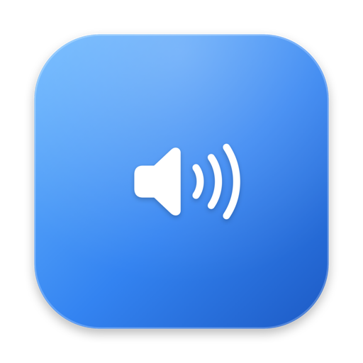
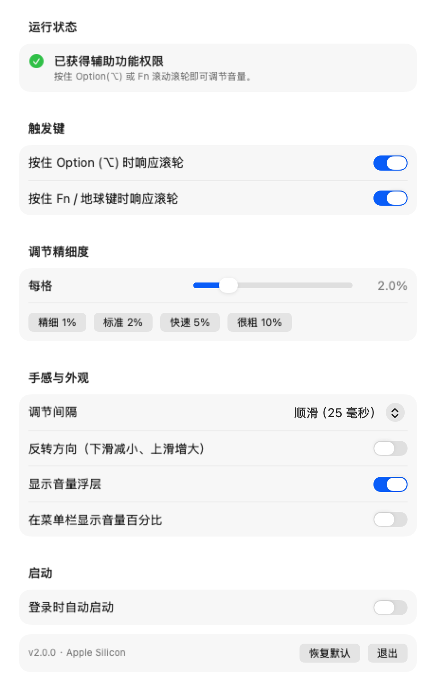

# WheelVolume

> 按住 `Option`（或 `Fn` / 地球键）滚动鼠标滚轮，无级、丝滑地调节 macOS 系统音量。
> **仅支持 Apple Silicon（M 系列芯片）Mac，macOS 13 及以上。**

[](https://github.com/googlemr/WheelVolume/releases)
[](LICENSE)
[](docs/INSTALL.md)



## 它解决什么问题

macOS 系统音量只有 16 格，按音量键一跳就是 6% 以上，想停在"刚好"的那一档很难。
WheelVolume 让你用滚轮以 **2% 一档**调节（可细到 0.2%），手不离鼠标，还带一个轻量音量浮层。

## 功能

- **无级调节**：0.2%–10% 可调，走 CoreAudio 浮点音量，不受系统 16 格限制。
- **修饰键触发**：按住 `Option` 或 `Fn` 再滚，普通滚动完全不受影响（事件被吞掉，不会边调音量边滚页面）。
- **方向可反转**：默认 **上滑减小、下滑增大**，一键反向。
- **菜单栏常驻**：扬声器图标 + 实时音量菜单，可选在菜单栏显示百分比。
- **图形化设置**：调节精细度、触发键、响应间隔、浮层、开机自启，全部可视化。
- **音量浮层**：HUD 样式半透明面板，0.85 秒后淡出。
- **纯原生、零依赖**：Swift + 系统框架，无第三方库、无联网、无数据收集。



## 安装

1. 到 [Releases](https://github.com/googlemr/WheelVolume/releases) 下载
   `WheelVolume-v<版本>-arm64.dmg`。
2. 双击挂载，把 **WheelVolume.app** 拖到右边的「应用程序」文件夹。
3. 打开「应用程序」里的 WheelVolume。若提示 **"Apple 无法验证"**，
   到 **系统设置 → 隐私与安全性 → 仍要打开**（只需一次）。
4. 程序会自动弹出设置窗口，点 **去授权**，在
   **系统设置 → 隐私与安全性 → 辅助功能** 中勾选 WheelVolume。

也可以双击 DMG 里的 `安装.command`，它会自动完成安装、清除隔离标记、校验签名并启动。

> **为什么会出现"无法验证"？**
> 本项目没有 Apple 付费开发者证书（99 美元/年），无法做公证（notarization）。
> 代码签名是有效的 ad-hoc 签名，文件没有损坏；按上面的"仍要打开"流程即可。
> 详见 [安装说明](docs/INSTALL.md)。

### 从源码构建

```bash
git clone https://github.com/googlemr/WheelVolume.git
cd WheelVolume
./Scripts/build.sh          # 生成 dist/WheelVolume.app + DMG + ZIP
./Scripts/install.sh        # 安装到「应用程序」并启动
```

需要 Xcode Command Line Tools（`xcode-select --install`）。图标由 `Scripts/make-icon.swift`
在构建时用 Core Graphics 现场绘制，仓库不依赖任何外部设计素材。

## 使用

| 操作 | 效果 |
| --- | --- |
| `Option` + 滚轮上滑 | 音量减小（默认 -2%/格） |
| `Option` + 滚轮下滑 | 音量增加（默认 +2%/格） |
| `Fn` / 地球键 + 滚轮 | 同上，可在设置中单独关闭 |
| 不按修饰键滚动 | 正常滚动页面，不受影响 |
| 点菜单栏扬声器图标 | 查看当前音量、打开设置、退出 |

设置保存在 `UserDefaults`（bundle id `com.shanlin.WheelVolume`），改动即时生效，无需重启。

## 文档索引

| 文档 | 内容 |
| --- | --- |
| [安装说明](docs/INSTALL.md) | DMG/ZIP 安装、Gatekeeper 处理、源码构建、卸载 |
| [使用说明](docs/USAGE.md) | 操作、全部设置项、开机自启 |
| [权限说明](docs/PERMISSIONS.md) | 为什么需要辅助功能权限、隐私边界 |
| [常见问题](docs/FAQ.md) | 不生效、方向反了、无法验证、旧版残留 |
| [更新日志](CHANGELOG.md) | 各版本变更 |
| [贡献指南](CONTRIBUTING.md) | 开发环境、构建、提交规范 |
| [发布流程](docs/RELEASE.md) | 版本号、构建、打 tag、上传 Release |
| [反馈渠道](docs/FEEDBACK.md) | Issue、讨论区、安全问题上报 |

## 目录结构

```
WheelVolume/
├── src/WheelVolume.swift      # 全部源码（单文件：AppKit + SwiftUI + CoreAudio + CGEventTap）
├── Resources/
│   ├── Info.plist             # bundle 元数据（LSUIElement / NSPrincipalClass / 图标）
│   ├── 安装.command            # 可选的一键安装脚本
│   └── 安装说明.txt
├── Scripts/
│   ├── build.sh               # 编译 → 组装 .app → 签名 → DMG/ZIP + SHA256
│   ├── make-icon.swift        # 用 Core Graphics 绘制 AppIcon.icns
│   └── install.sh             # 本机安装
├── docs/                      # 分主题文档与截图
├── .github/                   # Issue/PR 模板、CI
└── dist/                      # 构建产物
```

## 技术说明

- **应用结构**：标准 AppKit 应用（`NSApplication` + `AppDelegate`），`LSUIElement=1`
  仅驻留菜单栏；设置界面用 SwiftUI（`NSHostingController`）承载。
  v1.x 是"命令行程序装进 .app"，缺少 AppKit 启动回执，会被 Finder 判为"没有响应"，
  2.0.0 已彻底修正。
- **事件监听**：`CGEventTap`（`kCGHIDEventTap`）只订阅 `scrollWheel`，回调内只做
  浮点运算与一次 CoreAudio 写入，避免监听超时被系统禁用；同时对
  `tapDisabledByTimeout` 自动重新启用。
- **音量控制**：`kAudioDevicePropertyVolumeScalar`（0.0–1.0），主元素失败时回退
  到声道元素，兼容不支持主音量的外置声卡与显示器。
- **可复现构建**：`build.sh` 校验 arm64 架构、生成图标、整包签名并做
  `codesign --verify --deep --strict`；产物带 SHA-256 清单。

## 许可证

[MIT](LICENSE) © 2026 Shanlin Du

## 反馈

遇到 bug 或想要新功能，请到 [Issues](https://github.com/googlemr/WheelVolume/issues)
提交；安全问题请按 [反馈渠道](docs/FEEDBACK.md) 中的私有方式上报。
